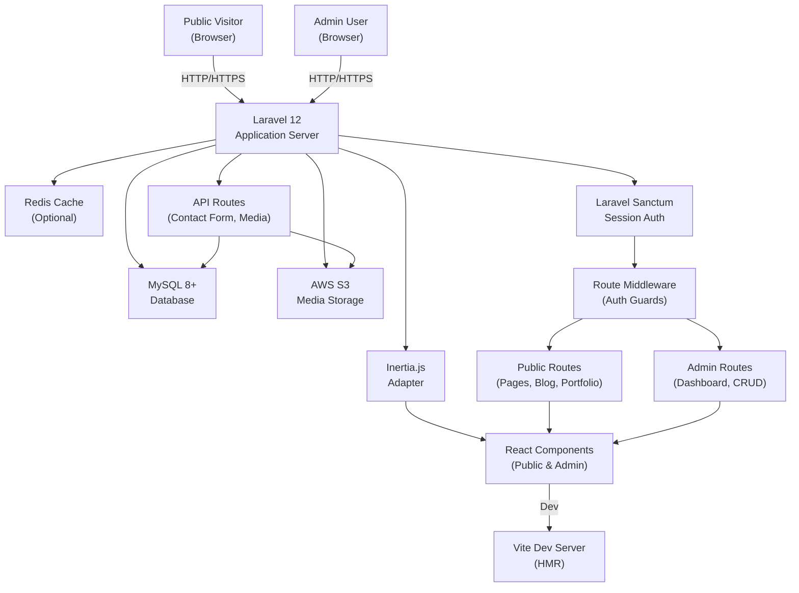
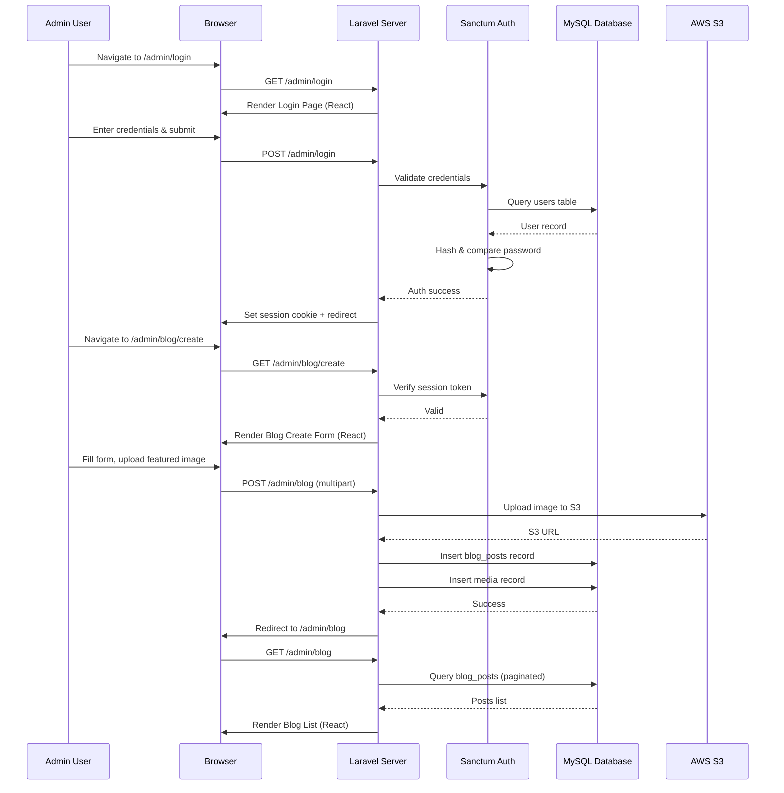
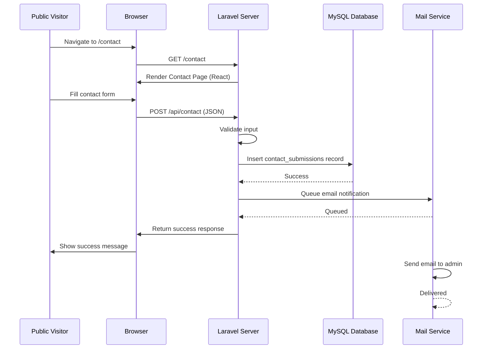

# ARCHITECTURE.md: ProfilKorp

## System Overview

ProfilKorp is a monolithic Laravel 12 application with a React frontend integrated via Inertia.js, designed to deliver a high-performance corporate profile website with a secure admin dashboard. The architecture follows a traditional server-side rendering (SSR) pattern enhanced by Inertia's reactive components, eliminating the need for a separate API layer. All media assets are stored on AWS S3, the database is MySQL 8+, and the application is deployed on a VPS. The system is optimized for fast page loads, security, and ease of content management by a single administrator.

## High-Level Architecture Diagram

## Component Breakdown

### Laravel 12 Application Server

The core backend application handles all business logic, routing, and data persistence. It serves as the single source of truth for both the public website and admin dashboard. Key responsibilities include:

- **Request Routing:** Directs incoming HTTP requests to appropriate controllers based on public, admin, or API routes.
- **Authentication & Authorization:** Manages session-based authentication via Laravel Sanctum for the single admin user.
- **Data Validation:** Enforces validation rules on all incoming data (contact forms, content updates, media uploads).
- **Database Queries:** Executes all database operations with optimized eager loading and query caching.
- **File Operations:** Handles media uploads to AWS S3 and manages file metadata in the database.

### Inertia.js Adapter

Inertia.js bridges Laravel and React, enabling server-side routing with client-side reactivity. It eliminates the need for a separate REST API by passing data directly from Laravel controllers to React components as props.

- **Server-Side Rendering:** Renders React components on the server for the initial page load, improving SEO and performance.
- **Client-Side Navigation:** Enables smooth, SPA-like navigation without full page reloads after the initial load.
- **Props Serialization:** Automatically serializes Laravel data (models, arrays) into JSON props for React components.

### React Components (Public & Admin)

React components are organized into two main sections: public-facing pages and admin dashboard interfaces. All components use Tailwind CSS for styling.

- **Public Components:** Homepage, About, Services, Portfolio, Team, Blog, Testimonials, Contact Form, individual detail pages.
- **Admin Components:** Dashboard overview, CRUD forms for content management, media library, SEO editor, settings panel, contact submission viewer.
- **Shared Components:** Navigation, footer, modals, form inputs, pagination, loading states.

### MySQL 8+ Database

Stores all application data with a relational schema optimized for the corporate profile use case.

**Core Tables:**
- `users` — Single admin account with hashed password and session tokens.
- `pages` — Static pages (About, Services overview) with title, slug, content, meta tags.
- `page_versions` — Historical versions of page content for rollback capability.
- `services` — Service listings with descriptions, images, and associated metadata.
- `projects` — Portfolio projects with title, description, images, videos, and service associations.
- `team_members` — Team profiles with name, title, photo, bio.
- `blog_posts` — Articles with title, slug, content, author, publication status, created/updated timestamps.
- `blog_categories` — Categories for organizing blog posts.
- `blog_tags` — Tags for blog posts.
- `testimonials` — Client testimonials with approval status.
- `contact_submissions` — Contact form submissions with name, email, subject, message, timestamp, and archive status.
- `media` — Metadata for all uploaded files (filename, S3 URL, file type, size, upload timestamp).
- `settings` — Global site configuration (company name, logo URL, contact email, phone, address, social links).

### AWS S3 Media Storage

Cloud-based file storage for all company media assets (images, videos, documents). Provides high availability, durability, and scalability.

- **Bucket Configuration:** Versioning enabled for data recovery; lifecycle policies to archive old versions; public read access for media served to visitors.
- **IAM Policy:** Restrictive permissions for the application user (upload, delete, list only within the application's designated folder).
- **CDN Integration:** Optional CloudFront distribution for faster global asset delivery.

### Redis Cache (Optional)

In-memory cache layer for reducing database load and improving response times.

- **Query Caching:** Cache frequently accessed data (settings, service listings, team members).
- **Session Storage:** Optional session driver for distributed deployments.
- **Rate Limiting:** Stores rate limit counters for login and contact form endpoints.

### Laravel Sanctum & Session Authentication

Lightweight authentication system for the single admin user.

- **Session-Based Tokens:** Sanctum generates secure session tokens stored in HTTP-only cookies.
- **CSRF Protection:** Laravel's built-in CSRF middleware protects against cross-site request forgery.
- **Login Endpoint:** Validates credentials against the `users` table and creates an authenticated session.
- **Logout:** Invalidates the session token and clears the cookie.

### Route Middleware & Guards

Middleware layers enforce authentication and authorization rules.

- **Auth Guard:** Checks for valid session token on protected routes (admin dashboard, API endpoints).
- **Guest Guard:** Redirects authenticated users away from the login page.
- **Rate Limiting:** Throttles login attempts and contact form submissions to prevent abuse.
- **HTTPS Enforcement:** Redirects all HTTP traffic to HTTPS.

## Critical Flow Sequence Diagrams

### Admin Login & Content Update Flow

### Public Contact Form Submission Flow

## Deployment Strategy

### Application Server (VPS)

The Laravel application is deployed on a VPS (Linode, DigitalOcean, or AWS EC2) running Ubuntu 22.04 LTS.

- **Web Server:** Nginx configured as a reverse proxy to the Laravel application.
- **PHP Runtime:** PHP 8.3+ with FPM (FastCGI Process Manager) for handling requests.
- **Process Manager:** Supervisor manages Laravel queue workers for asynchronous tasks (email sending, media processing).
- **SSL/TLS:** Let's Encrypt certificate for HTTPS enforcement.
- **Deployment:** Git-based deployment via GitHub Actions or manual SSH deployment.

### Database Server

MySQL 8+ runs on the same VPS or a managed database service (AWS RDS, DigitalOcean Managed Databases).

- **Backups:** Automated daily backups with 30-day retention.
- **Replication:** Optional read replicas for high-traffic scenarios.
- **Monitoring:** Query performance monitoring and slow query logging.

### Media Storage (AWS S3)

All media assets are stored in a dedicated S3 bucket with the following configuration:

- **Bucket Name:** `profilkorp-media` (or similar).
- **Region:** Closest to the primary user base for latency optimization.
- **Versioning:** Enabled for data recovery.
- **Public Access:** Configured to allow public read access for media served to visitors.
- **CDN:** Optional CloudFront distribution for global asset delivery.

### Caching Layer (Redis)

Redis is deployed on the VPS or as a managed service (AWS ElastiCache, DigitalOcean Managed Redis).

- **Configuration:** Configured as the session driver and cache store in Laravel.
- **Memory:** Allocated based on expected cache size (typically 512MB–2GB for this application).
- **Persistence:** Optional RDB snapshots for durability.

### DNS & Domain

The domain is registered with a DNS provider and configured to point to the VPS's public IP address.

- **DNS Records:** A record for the domain, CNAME for `www` subdomain.
- **SSL Certificate:** Managed via Let's Encrypt with auto-renewal.

### Monitoring & Logging

- **Application Logs:** Stored in `/storage/logs` with daily rotation.
- **Server Monitoring:** CPU, memory, disk usage monitored via VPS provider dashboard or third-party tools (e.g., New Relic, Datadog).
- **Error Tracking:** Optional integration with Sentry for real-time error notifications.
- **Analytics:** Google Analytics integration for visitor tracking and behavior analysis.

## Data Flow Architecture

### Public Page Request Flow

1. Visitor requests a public page (e.g., `/services`).
2. Nginx routes the request to the Laravel application.
3. Laravel router matches the route to a controller action.
4. Controller queries the database for page content (with caching if available).
5. Controller passes data to an Inertia response, which renders the React component.
6. React component receives props and renders HTML with Tailwind CSS styling.
7. Inertia serializes the response as JSON for client-side hydration.
8. Browser receives the HTML and JavaScript, hydrates the React component.
9. Visitor sees the fully rendered page with interactive elements.

### Admin Content Update Flow

1. Admin logs in via `/admin/login` with credentials.
2. Laravel Sanctum validates credentials and creates a session token.
3. Admin navigates to the admin dashboard (`/admin`).
4. Middleware verifies the session token; if valid, the dashboard is rendered.
5. Admin clicks "Edit" on a page or post.
6. React form component is rendered with existing content pre-filled.
7. Admin modifies content and submits the form.
8. Laravel controller validates the input and updates the database record.
9. If media is uploaded, it is sent to AWS S3 and the S3 URL is stored in the database.
10. A success response is returned to the browser.
11. React component updates the UI to reflect the changes.

## Security Architecture

### Authentication & Authorization

- **Single Admin Account:** Only one user account exists in the system. Credentials are stored as a bcrypt hash in the `users` table.
- **Session-Based Auth:** Laravel Sanctum manages session tokens stored in HTTP-only cookies, preventing XSS attacks.
- **CSRF Protection:** All state-changing requests (POST, PUT, DELETE) require a valid CSRF token.
- **Rate Limiting:** Login attempts and contact form submissions are rate-limited to prevent brute-force attacks and spam.

### Data Protection

- **HTTPS Enforcement:** All traffic is encrypted in transit via TLS 1.2+.
- **Input Validation:** All user inputs are validated server-side using Laravel's validation rules.
- **SQL Injection Prevention:** Parameterized queries via Laravel's query builder prevent SQL injection.
- **XSS Prevention:** React automatically escapes content; WYSIWYG editor output is sanitized server-side.
- **File Upload Security:** Uploaded files are validated for type and size; stored outside the web root on S3.

### AWS S3 Security

- **IAM Policy:** Restrictive permissions limit the application's access to only the designated bucket and folder.
- **Bucket Policy:** Public read access is configured only for media files; all other operations require authentication.
- **Versioning:** Enabled to recover from accidental deletions or malicious overwrites.
- **Encryption:** Server-side encryption (AES-256) is enabled for all objects.

## Performance Optimization

### Caching Strategy

- **Page Caching:** Static pages (About, Services overview) are cached for 1 hour.
- **Query Caching:** Frequently accessed data (settings, team members) are cached for 24 hours.
- **Asset Caching:** CSS, JavaScript, and images are cached with long expiration headers (1 year).
- **Cache Invalidation:** Cache is automatically invalidated when content is updated via the admin panel.

### Database Optimization

- **Eager Loading:** Related data is loaded in a single query using Laravel's `with()` method to prevent N+1 queries.
- **Indexing:** Indexes are created on frequently queried columns (slug, status, created_at).
- **Query Optimization:** Slow queries are identified and optimized using EXPLAIN analysis.

### Frontend Optimization

- **Code Splitting:** React components are code-split by route to reduce initial bundle size.
- **Lazy Loading:** Images are lazy-loaded using the `loading="lazy"` attribute.
- **Minification:** CSS and JavaScript are minified in production via Vite.
- **Compression:** Gzip compression is enabled on the web server for all text-based responses.

## Scalability Considerations

### Horizontal Scaling

- **Stateless Application:** The Laravel application is stateless, allowing multiple instances to run behind a load balancer.
- **Session Storage:** Sessions are stored in Redis (not file-based), enabling session sharing across instances.
- **Database Connection Pooling:** Connection pooling is configured to efficiently manage database connections across multiple application instances.

### Vertical Scaling

- **VPS Upgrade:** If traffic increases, the VPS can be upgraded to a larger instance size with more CPU and memory.
- **Database Optimization:** Query optimization and indexing can improve performance without additional hardware.

### Load Balancing

- **Nginx Load Balancer:** Multiple application instances can be deployed behind an Nginx load balancer for traffic distribution.
- **CDN:** CloudFront can be used to cache static assets and reduce load on the origin server.

## Development & Build Pipeline

### Local Development

- **Laravel Vite:** Vite is configured for hot module replacement (HMR) during development, enabling instant feedback on code changes.
- **Database Seeding:** Laravel seeders populate the database with sample data for testing.
- **Artisan Commands:** Custom Artisan commands are available for common tasks (cache clearing, database migrations).

### Production Build

- **Vite Build:** `npm run build` compiles React components and CSS into optimized production bundles.
- **Asset Versioning:** Vite automatically versions assets to prevent caching issues.
- **Minification & Optimization:** CSS and JavaScript are minified; unused CSS is purged via Tailwind's PurgeCSS.

### Deployment

- **Git-Based Deployment:** Code is pushed to a Git repository (GitHub, GitLab); deployment is triggered via webhook or manual SSH.
- **Database Migrations:** Laravel migrations are run automatically during deployment to update the schema.
- **Cache Clearing:** Application cache is cleared after deployment to ensure fresh data.