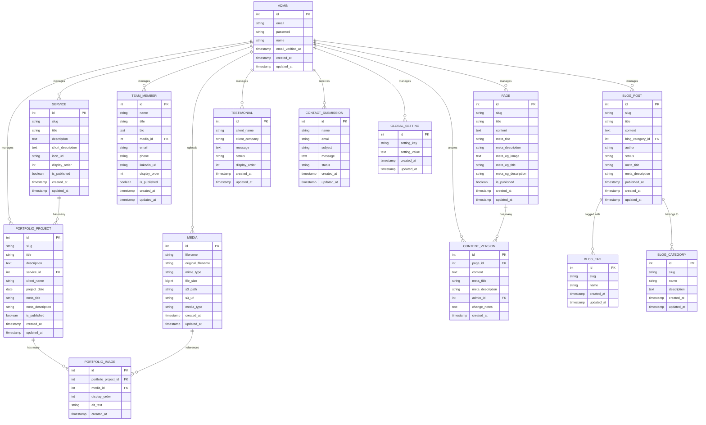

# DATABASE.md: ProfilKorp

## Entity Relationship Diagram



## Table Definitions

### ADMIN
Stores the single administrator account credentials and profile information.

| Column | Type | Constraints | Description |
|:---|:---|:---|:---|
| id | INT | PK, AUTO_INCREMENT | Unique identifier |
| email | VARCHAR(255) | UK, NOT NULL | Admin login email |
| password | VARCHAR(255) | NOT NULL | Hashed password (bcrypt) |
| name | VARCHAR(255) | NOT NULL | Administrator full name |
| email_verified_at | TIMESTAMP | NULLABLE | Email verification timestamp |
| created_at | TIMESTAMP | DEFAULT CURRENT_TIMESTAMP | Record creation time |
| updated_at | TIMESTAMP | DEFAULT CURRENT_TIMESTAMP ON UPDATE | Last update time |

### PAGE
Stores static page content (About Us, Services overview, etc.). Each page has a unique slug for URL generation.

| Column | Type | Constraints | Description |
|:---|:---|:---|:---|
| id | INT | PK, AUTO_INCREMENT | Unique identifier |
| slug | VARCHAR(255) | UK, NOT NULL | URL-friendly identifier (e.g., "about-us") |
| title | VARCHAR(255) | NOT NULL | Page title |
| content | LONGTEXT | NOT NULL | WYSIWYG editor content (HTML) |
| meta_title | VARCHAR(255) | NULLABLE | SEO meta title |
| meta_description | VARCHAR(255) | NULLABLE | SEO meta description |
| meta_og_image | TEXT | NULLABLE | Open Graph image URL |
| meta_og_title | VARCHAR(255) | NULLABLE | Open Graph title |
| meta_og_description | VARCHAR(255) | NULLABLE | Open Graph description |
| is_published | BOOLEAN | DEFAULT 1 | Publication status |
| created_at | TIMESTAMP | DEFAULT CURRENT_TIMESTAMP | Record creation time |
| updated_at | TIMESTAMP | DEFAULT CURRENT_TIMESTAMP ON UPDATE | Last update time |

### SERVICE
Stores company service offerings. Each service can be linked to multiple portfolio projects.

| Column | Type | Constraints | Description |
|:---|:---|:---|:---|
| id | INT | PK, AUTO_INCREMENT | Unique identifier |
| slug | VARCHAR(255) | UK, NOT NULL | URL-friendly identifier |
| title | VARCHAR(255) | NOT NULL | Service name |
| description | LONGTEXT | NOT NULL | Detailed service description |
| short_description | TEXT | NULLABLE | Brief summary for listings |
| icon_url | VARCHAR(255) | NULLABLE | URL to service icon (S3) |
| display_order | INT | DEFAULT 0 | Sort order on public page |
| is_published | BOOLEAN | DEFAULT 1 | Publication status |
| created_at | TIMESTAMP | DEFAULT CURRENT_TIMESTAMP | Record creation time |
| updated_at | TIMESTAMP | DEFAULT CURRENT_TIMESTAMP ON UPDATE | Last update time |

### PORTFOLIO_PROJECT
Stores completed projects/case studies. Links to services and contains multiple images via PORTFOLIO_IMAGE.

| Column | Type | Constraints | Description |
|:---|:---|:---|:---|
| id | INT | PK, AUTO_INCREMENT | Unique identifier |
| slug | VARCHAR(255) | UK, NOT NULL | URL-friendly identifier |
| title | VARCHAR(255) | NOT NULL | Project title |
| description | LONGTEXT | NOT NULL | Project details and outcomes |
| service_id | INT | FK (SERVICE.id) | Associated service category |
| client_name | VARCHAR(255) | NOT NULL | Client company name |
| project_date | DATE | NOT NULL | Project completion date |
| meta_title | VARCHAR(255) | NULLABLE | SEO meta title |
| meta_description | VARCHAR(255) | NULLABLE | SEO meta description |
| is_published | BOOLEAN | DEFAULT 1 | Publication status |
| created_at | TIMESTAMP | DEFAULT CURRENT_TIMESTAMP | Record creation time |
| updated_at | TIMESTAMP | DEFAULT CURRENT_TIMESTAMP ON UPDATE | Last update time |

### PORTFOLIO_IMAGE
Junction table linking portfolio projects to media files. Supports multiple images per project with display order.

| Column | Type | Constraints | Description |
|:---|:---|:---|:---|
| id | INT | PK, AUTO_INCREMENT | Unique identifier |
| portfolio_project_id | INT | FK (PORTFOLIO_PROJECT.id) | Associated project |
| media_id | INT | FK (MEDIA.id) | Associated media file |
| display_order | INT | DEFAULT 0 | Image order in gallery |
| alt_text | VARCHAR(255) | NULLABLE | Accessibility alt text |
| created_at | TIMESTAMP | DEFAULT CURRENT_TIMESTAMP | Record creation time |

### TEAM_MEMBER
Stores team member profiles with photos and contact information.

| Column | Type | Constraints | Description |
|:---|:---|:---|:---|
| id | INT | PK, AUTO_INCREMENT | Unique identifier |
| name | VARCHAR(255) | NOT NULL | Team member full name |
| title | VARCHAR(255) | NOT NULL | Job title/position |
| bio | TEXT | NULLABLE | Brief biography |
| media_id | INT | FK (MEDIA.id), NULLABLE | Profile photo |
| email | VARCHAR(255) | NULLABLE | Contact email |
| phone | VARCHAR(20) | NULLABLE | Contact phone |
| linkedin_url | VARCHAR(255) | NULLABLE | LinkedIn profile URL |
| display_order | INT | DEFAULT 0 | Sort order on team page |
| is_published | BOOLEAN | DEFAULT 1 | Publication status |
| created_at | TIMESTAMP | DEFAULT CURRENT_TIMESTAMP | Record creation time |
| updated_at | TIMESTAMP | DEFAULT CURRENT_TIMESTAMP ON UPDATE | Last update time |

### BLOG_POST
Stores blog articles with categorization, tagging, and publication workflow.

| Column | Type | Constraints | Description |
|:---|:---|:---|:---|
| id | INT | PK, AUTO_INCREMENT | Unique identifier |
| slug | VARCHAR(255) | UK, NOT NULL | URL-friendly identifier |
| title | VARCHAR(255) | NOT NULL | Article title |
| content | LONGTEXT | NOT NULL | Article body (HTML from WYSIWYG) |
| blog_category_id | INT | FK (BLOG_CATEGORY.id), NULLABLE | Article category |
| author | VARCHAR(255) | NOT NULL | Author name |
| status | ENUM('draft','published','archived') | DEFAULT 'draft' | Publication status |
| meta_title | VARCHAR(255) | NULLABLE | SEO meta title |
| meta_description | VARCHAR(255) | NULLABLE | SEO meta description |
| published_at | TIMESTAMP | NULLABLE | Publication timestamp |
| created_at | TIMESTAMP | DEFAULT CURRENT_TIMESTAMP | Record creation time |
| updated_at | TIMESTAMP | DEFAULT CURRENT_TIMESTAMP ON UPDATE | Last update time |

### BLOG_CATEGORY
Stores blog post categories for organization and filtering.

| Column | Type | Constraints | Description |
|:---|:---|:---|:---|
| id | INT | PK, AUTO_INCREMENT | Unique identifier |
| slug | VARCHAR(255) | UK, NOT NULL | URL-friendly identifier |
| name | VARCHAR(255) | NOT NULL | Category name |
| description | TEXT | NULLABLE | Category description |
| created_at | TIMESTAMP | DEFAULT CURRENT_TIMESTAMP | Record creation time |
| updated_at | TIMESTAMP | DEFAULT CURRENT_TIMESTAMP ON UPDATE | Last update time |

### BLOG_TAG
Stores blog post tags for flexible content organization.

| Column | Type | Constraints | Description |
|:---|:---|:---|:---|
| id | INT | PK, AUTO_INCREMENT | Unique identifier |
| slug | VARCHAR(255) | UK, NOT NULL | URL-friendly identifier |
| name | VARCHAR(255) | NOT NULL | Tag name |
| created_at | TIMESTAMP | DEFAULT CURRENT_TIMESTAMP | Record creation time |
| updated_at | TIMESTAMP | DEFAULT CURRENT_TIMESTAMP ON UPDATE | Last update time |

### TESTIMONIAL
Stores client testimonials with approval workflow for public display.

| Column | Type | Constraints | Description |
|:---|:---|:---|:---|
| id | INT | PK, AUTO_INCREMENT | Unique identifier |
| client_name | VARCHAR(255) | NOT NULL | Testimonial author name |
| client_company | VARCHAR(255) | NULLABLE | Client company name |
| message | TEXT | NOT NULL | Testimonial text |
| status | ENUM('pending','approved','rejected') | DEFAULT 'pending' | Approval status |
| display_order | INT | DEFAULT 0 | Sort order on public page |
| created_at | TIMESTAMP | DEFAULT CURRENT_TIMESTAMP | Record creation time |
| updated_at | TIMESTAMP | DEFAULT CURRENT_TIMESTAMP ON UPDATE | Last update time |

### CONTACT_SUBMISSION
Stores contact form submissions from public visitors.

| Column | Type | Constraints | Description |
|:---|:---|:---|:---|
| id | INT | PK, AUTO_INCREMENT | Unique identifier |
| name | VARCHAR(255) | NOT NULL | Visitor name |
| email | VARCHAR(255) | NOT NULL | Visitor email |
| subject | VARCHAR(255) | NOT NULL | Message subject |
| message | TEXT | NOT NULL | Message body |
| status | ENUM('new','read','archived') | DEFAULT 'new' | Admin review status |
| created_at | TIMESTAMP | DEFAULT CURRENT_TIMESTAMP | Submission timestamp |
| updated_at | TIMESTAMP | DEFAULT CURRENT_TIMESTAMP ON UPDATE | Last update time |

### MEDIA
Stores metadata for all uploaded files stored on AWS S3.

| Column | Type | Constraints | Description |
|:---|:---|:---|:---|
| id | INT | PK, AUTO_INCREMENT | Unique identifier |
| filename | VARCHAR(255) | NOT NULL | Stored filename on S3 |
| original_filename | VARCHAR(255) | NOT NULL | Original uploaded filename |
| mime_type | VARCHAR(100) | NOT NULL | File MIME type (e.g., image/jpeg) |
| file_size | BIGINT | NOT NULL | File size in bytes |
| s3_path | VARCHAR(255) | NOT NULL | Full S3 object path |
| s3_url | VARCHAR(255) | NOT NULL | Public S3 URL (CloudFront or direct) |
| media_type | ENUM('image','video','document') | DEFAULT 'image' | Content type classification |
| created_at | TIMESTAMP | DEFAULT CURRENT_TIMESTAMP | Upload timestamp |
| updated_at | TIMESTAMP | DEFAULT CURRENT_TIMESTAMP ON UPDATE | Last update time |

### CONTENT_VERSION
Stores historical versions of page content for rollback capability (FR-20).

| Column | Type | Constraints | Description |
|:---|:---|:---|:---|
| id | INT | PK, AUTO_INCREMENT | Unique identifier |
| page_id | INT | FK (PAGE.id) | Associated page |
| content | LONGTEXT | NOT NULL | Snapshot of page content |
| meta_title | VARCHAR(255) | NULLABLE | Snapshot of meta title |
| meta_description | VARCHAR(255) | NULLABLE | Snapshot of meta description |
| admin_id | INT | FK (ADMIN.id) | Administrator who made the change |
| change_notes | TEXT | NULLABLE | Admin notes about the change |
| created_at | TIMESTAMP | DEFAULT CURRENT_TIMESTAMP | Version creation timestamp |

### GLOBAL_SETTING
Stores site-wide configuration settings (company name, logo, contact info, social links).

| Column | Type | Constraints | Description |
|:---|:---|:---|:---|
| id | INT | PK, AUTO_INCREMENT | Unique identifier |
| setting_key | VARCHAR(255) | UK, NOT NULL | Setting identifier (e.g., "company_name") |
| setting_value | TEXT | NOT NULL | Setting value (JSON for complex data) |
| created_at | TIMESTAMP | DEFAULT CURRENT_TIMESTAMP | Record creation time |
| updated_at | TIMESTAMP | DEFAULT CURRENT_TIMESTAMP ON UPDATE | Last update time |

## Prisma Schema

```prisma
// This is your Prisma schema file,
// learn more about it in the docs: https://pris.ly/d/prisma-schema

generator client {
  provider = "prisma-client-js"
}

datasource db {
  provider = "mysql"
  url      = env("DATABASE_URL")
}

model Admin {
  id                Int       @id @default(autoincrement())
  email             String    @unique
  password          String
  name              String
  emailVerifiedAt   DateTime? @map("email_verified_at")
  createdAt         DateTime  @default(now()) @map("created_at")
  updatedAt         DateTime  @updatedAt @map("updated_at")

  contentVersions   ContentVersion[]

  @@map("admin")
}

model Page {
  id                Int       @id @default(autoincrement())
  slug              String    @unique
  title             String
  content           String    @db.LongText
  metaTitle         String?   @map("meta_title")
  metaDescription   String?   @map("meta_description")
  metaOgImage       String?   @db.Text @map("meta_og_image")
  metaOgTitle       String?   @map("meta_og_title")
  metaOgDescription String?   @map("meta_og_description")
  isPublished       Boolean   @default(true) @map("is_published")
  createdAt         DateTime  @default(now()) @map("created_at")
  updatedAt         DateTime  @updatedAt @map("updated_at")

  contentVersions   ContentVersion[]

  @@map("page")
}

model Service {
  id                Int       @id @default(autoincrement())
  slug              String    @unique
  title             String
  description       String    @db.LongText
  shortDescription  String?   @db.Text @map("short_description")
  iconUrl           String?   @map("icon_url")
  displayOrder      Int       @default(0) @map("display_order")
  isPublished       Boolean   @default(true) @map("is_published")
  createdAt         DateTime  @default(now()) @map("created_at")
  updatedAt         DateTime  @updatedAt @map("updated_at")

  portfolioProjects PortfolioProject[]

  @@map("service")
}

model PortfolioProject {
  id                Int       @id @default(autoincrement())
  slug              String    @unique
  title             String
  description       String    @db.LongText
  serviceId         Int       @map("service_id")
  clientName        String    @map("client_name")
  projectDate       DateTime  @map("project_date") @db.Date
  metaTitle         String?   @map("meta_title")
  metaDescription   String?   @map("meta_description")
  isPublished       Boolean   @default(true) @map("is_published")
  createdAt         DateTime  @default(now()) @map("created_at")
  updatedAt         DateTime  @updatedAt @map("updated_at")

  service           Service   @relation(fields: [serviceId], references: [id], onDelete: Cascade)
  portfolioImages   PortfolioImage[]

  @@map("portfolio_project")
}

model PortfolioImage {
  id                Int       @id @default(autoincrement())
  portfolioProjectId Int      @map("portfolio_project_id")
  mediaId           Int       @map("media_id")
  displayOrder      Int       @default(0) @map("display_order")
  altText           String?   @map("alt_text")
  createdAt         DateTime  @default(now()) @map("created_at")

  portfolioProject  PortfolioProject @relation(fields: [portfolioProjectId], references: [id], onDelete: Cascade)
  media             Media     @relation(fields: [mediaId], references: [id], onDelete: Cascade)

  @@map("portfolio_image")
}

model TeamMember {
  id                Int       @id @default(autoincrement())
  name              String
  title             String
  bio               String?   @db.Text
  mediaId           Int?      @map("media_id")
  email             String?
  phone             String?
  linkedinUrl       String?   @map("linkedin_url")
  displayOrder      Int       @default(0) @map("display_order")
  isPublished       Boolean   @default(true) @map("is_published")
  createdAt         DateTime  @default(now()) @map("created_at")
  updatedAt         DateTime  @updatedAt @map("updated_at")

  media             Media?    @relation(fields: [mediaId], references: [id], onDelete: SetNull)

  @@map("team_member")
}

model BlogPost {
  id                Int       @id @default(autoincrement())
  slug              String    @unique
  title             String
  content           String    @db.LongText
  blogCategoryId    Int?      @map("blog_category_id")
  author            String
  status            String    @default("draft") // 'draft', 'published', 'archived'
  metaTitle         String?   @map("meta_title")
  metaDescription   String?   @map("meta_description")
  publishedAt       DateTime? @map("published_at")
  createdAt         DateTime  @default(now()) @map("created_at")
  updatedAt         DateTime  @updatedAt @map("updated_at")

  blogCategory      BlogCategory? @relation(fields: [blogCategoryId], references: [id], onDelete: SetNull)
  blogTags          BlogTag[]

  @@map("blog_post")
}

model BlogCategory {
  id                Int       @id @default(autoincrement())
  slug              String    @unique
  name              String
  description       String?   @db.Text
  createdAt         DateTime  @default(now()) @map("created_at")
  updatedAt         DateTime  @updatedAt @map("updated_at")

  blogPosts         BlogPost[]

  @@map("blog_category")
}

model BlogTag {
  id                Int       @id @default(autoincrement())
  slug              String    @unique
  name              String
  createdAt         DateTime  @default(now()) @map("created_at")
  updatedAt         DateTime  @updatedAt @map("updated_at")

  blogPosts         BlogPost[]

  @@map("blog_tag")
}

model Testimonial {
  id                Int       @id @default(autoincrement())
  clientName        String    @map("client_name")
  clientCompany     String?   @map("client_company")
  message           String    @db.Text
  status            String    @default("pending") // 'pending', 'approved', 'rejected'
  displayOrder      Int       @default(0) @map("display_order")
  createdAt         DateTime  @default(now()) @map("created_at")
  updatedAt         DateTime  @updatedAt @map("updated_at")

  @@map("testimonial")
}

model ContactSubmission {
  id                Int       @id @default(autoincrement())
  name              String
  email             String
  subject           String
  message           String    @db.Text
  status            String    @default("new") // 'new', 'read', 'archived'
  createdAt         DateTime  @default(now()) @map("created_at")
  updatedAt         DateTime  @updatedAt @map("updated_at")

  @@map("contact_submission")
}

model Media {
  id                Int       @id @default(autoincrement())
  filename          String
  originalFilename  String    @map("original_filename")
  mimeType          String    @map("mime_type")
  fileSize          BigInt    @map("file_size")
  s3Path            String    @map("s3_path")
  s3Url             String    @map("s3_url")
  mediaType         String    @default("image") @map("media_type") // 'image', 'video', 'document'
  createdAt         DateTime  @default(now()) @map("created_at")
  updatedAt         DateTime  @updatedAt @map("updated_at")

  portfolioImages   PortfolioImage[]
  teamMembers       TeamMember[]

  @@map("media")
}

model ContentVersion {
  id                Int       @id @default(autoincrement())
  pageId            Int       @map("page_id")
  content           String    @db.LongText
  metaTitle         String?   @map("meta_title")
  metaDescription   String?   @map("meta_description")
  adminId           Int       @map("admin_id")
  changeNotes       String?   @db.Text @map("change_notes")
  createdAt         DateTime  @default(now()) @map("created_at")

  page              Page      @relation(fields: [pageId], references: [id], onDelete: Cascade)
  admin             Admin     @relation(fields: [adminId], references: [id], onDelete: Restrict)

  @@map("content_version")
}

model GlobalSetting {
  id                Int       @id @default(autoincrement())
  settingKey        String    @unique @map("setting_key")
  settingValue      String    @db.Text @map("setting_value")
  createdAt         DateTime  @default(now()) @map("created_at")
  updatedAt         DateTime  @updatedAt @map("updated_at")

  @@map("global_setting")
}
```

## Database Indexing Strategy

To optimize query performance, the following indexes are recommended beyond primary and foreign keys:

| Table | Column(s) | Type | Purpose |
|:---|:---|:---|:---|
| blog_post | status, published_at | Composite | Filter published posts by date |
| blog_post | blog_category_id | Single | Join queries for category filtering |
| portfolio_project | service_id, is_published | Composite | Filter projects by service |
| contact_submission | status, created_at | Composite | List submissions by status and date |
| testimonial | status, display_order | Composite | Fetch approved testimonials in order |
| media | created_at | Single | Sort media by upload date |
| global_setting | setting_key | Single | Fast lookup of configuration values |

## Data Integrity & Constraints

- **Referential Integrity:** All foreign keys enforce CASCADE or RESTRICT delete policies to prevent orphaned records.
- **Unique Constraints:** Slugs are unique across their respective tables to ensure clean, predictable URLs.
- **Email Validation:** The ADMIN.email field must be validated as a valid email format at the application layer.
- **Enum Fields:** Status fields (blog_post.status, testimonial.status, contact_submission.status) use ENUM types to restrict values to predefined options.
- **Timestamps:** All tables include created_at and updated_at timestamps for audit trails and sorting.

## Migration & Seeding

See ARCHITECTURE.md for migration strategy and seeding guidelines. Database migrations will be managed via Prisma Migrate with Prisma schema as the source of truth.

## Performance Considerations

- **Query Optimization:** Use eager loading (Prisma's `include`) to prevent N+1 queries when fetching related data (e.g., portfolio projects with images).
- **Pagination:** Implement cursor-based or offset-based pagination for large result sets (blog posts, portfolio projects).
- **Caching:** Cache frequently accessed data (global settings, published services, approved testimonials) using Redis to reduce database load.
- **Full-Text Search:** For blog post and portfolio project searches, consider adding MySQL FULLTEXT indexes on title and description fields.

## Security & Compliance

- **SQL Injection Prevention:** All queries must use parameterized statements via Prisma ORM.
- **Data Encryption:** Sensitive fields (admin password) are hashed using bcrypt. Consider encrypting S3 URLs if they contain sensitive metadata.
- **Access Control:** Database access is restricted to the Laravel application user with minimal required privileges (no DROP, ALTER on production).
- **Audit Trail:** ContentVersion table maintains a complete history of page changes for compliance and rollback purposes.